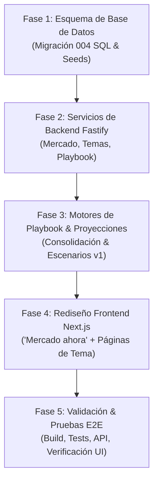

# Plan de Implementación: eTrade Trading Intelligence (ETI) — Addendum v2.2

**Documento Base:** [`C:\Fuentes\ETI\docs\eTrade_ETI_Addendum_v2_2_Temas_y_Dashboard.md`](file:///C:/Fuentes/ETI/docs/eTrade_ETI_Addendum_v2_2_Temas_y_Dashboard.md)  
**Versión del Plan:** 1.0  
**Fecha:** 31 de Octubre de 2026  
**Alcance Inmediato:** Tema **Opciones** (Activo). Temas **Scalping** y **Swing Trading** (Preparados como `PLANNED`).

---

## 1. Objetivos de la Mejora (Addendum v2.2)

1. **Arquitectura por Temas (`topic`):**
   * Reemplazar la ambigüedad del término «Canal» por el modelo jerárquico: **Tema** (`topic`) $\to$ **Fuente** (`source`) $\to$ **Playbook** $\to$ **Horizonte** (`horizon`).
   * Activación única e inmediata del Tema **Opciones** (MVP). Dejar creados e inactivos los Temas **Scalping** y **Swing Trading** (`PLANNED`).
2. **Fuentes Iniciales de Opciones (5 Creadores):**
   * Opción Sigma (Luis Hernán Silva) → `ENTRY_RULES` + `MARKET_CONTEXT`
   * Gala Trades → `ENTRY_RULES` (retest / pivots)
   * Yoel Sardiñas → `ENTRY_RULES` + `EDUCATION`
   * Imran Lakha (Options Insight) → `MARKET_CONTEXT` (GEX / IV / 0DTE)
   * John Carter (Simpler Trading) → `ENTRY_RULES` + `RISK_MGMT` (TTM Squeeze)
3. **Playbook Consolidado por Tema:**
   * Consolidación de reglas de todas las fuentes: Consenso, variantes de parámetros, contradicciones, horizonte y nivel de evidencia.
   * Regla de diseño: **Consenso NO es validez.** Columnas separadas de consenso y validación formal.
4. **Rediseño Integral del Dashboard — «Mercado Ahora» (Landing):**
   * **Estado y Proyección:** Panel de instrumentos clave (SPY/SPX, QQQ/NDX, DIA, IWM, VIX, US10Y, DXY) con régimen RADAR, niveles clave y escenarios alcista/lateral/bajista con niveles de activación/invalidación (sin probabilidades no calibradas).
   * **Resumen de Mercado (tipo Finviz con datos institucionales propios):** Barras de amplitud del S&P 500, sesgo de sesión con fórmula explícita, tabla de top movers y mapa de calor sectorial.
5. **Navegación Multinivel:**
   * `Mercado ahora` $\to$ `Temas (Opciones / Scalping / Swing)` $\to$ `Playbook` $\to$ `Fuentes` $\to$ `Knowledge Explorer` $\to$ `Review Queue` $\to$ `Operación & Settings`.
6. **Integración con eTrade Robot (`POST /api/eti/v1/context`):**
   * Soporte de `topic`, `horizon`, `consumer_module` y matriz de aplicabilidad régimen × regla.

---

## 2. Fases de Ejecución

---

### Fase 1: Esquema de Base de Datos (Migración 004)
* Crear `C:\Fuentes\ETI\database\migrations\004_eti_topics_playbooks_market.sql`:
  * Tablas de Temas y Playbooks:
    * `eti_topics` (`id`, `code`, `name`, `status`, `description`)
    * `eti_topic_sources` (`id`, `topic_id`, `source_id`, `role`, `priority`)
    * `eti_playbooks`, `eti_playbook_versions`, `eti_playbook_rules`, `eti_playbook_rule_members`, `eti_playbook_conflicts`, `eti_summaries`
  * Tablas de Mercado:
    * `eti_market_instruments`, `eti_market_snapshots`, `eti_market_breadth`, `eti_market_movers`, `eti_market_projections`, `eti_projection_scores`
  * Alteraciones a tablas existentes:
    * Añadir `topic_id`, `horizon_declared`, `horizon_effective` a `eti_strategies`, `eti_strategy_rules`, `eti_experience_candidates`, `eti_experience_trades`, `eti_shadow_signals`.
  * Seeds iniciales:
    * Temas: `OPTIONS` (ACTIVE), `SCALPING` (PLANNED), `SWING_TRADING` (PLANNED).
    * Fuentes iniciales vinculadas con roles y prioridad.
    * Instrumentos de mercado monitoreados (SPY, QQQ, DIA, IWM, VIX, US10Y, DXY).

---

### Fase 2: Motor Fastify & Servicios de Mercado Centralizados
* Implementar servicios de datos con caché centralizada en servidor (1-5 min) para evitar sobreconsumo de cuotas:
  * `backend/engine/src/services/marketDataService.ts`:
    * Snapshots de índices y VIX con cálculo de régimen RADAR (EMAs, ATR percentile, RSI).
    * Amplitud del S&P 500 y cálculo transparente de «Sesgo de Sesión».
    * Top Movers (Gainers, Losers, Unusual Volume).
    * Mapa de Calor del S&P 500 por sector.
  * Rutas Fastify:
    * `backend/engine/src/routes/market.ts` (`/api/eti/v1/market/*`)
    * `backend/engine/src/routes/topics.ts` (`/api/eti/v1/topics/*`)
    * Actualizar `backend/engine/src/routes/recommendations.ts` para aceptar `POST /api/eti/v1/context` con `topic` y `horizon`.

---

### Fase 3: Motores de Playbook & Proyecciones v1
* `backend/python/playbook/playbook_consolidation_engine.py`:
  * Algoritmo de agrupación de reglas por hash normalizado y similitud semántica.
  * Clasificación de Consenso ($\ge 3$ fuentes) vs Contradicciones vs Nivel de Evidencia.
* `backend/python/market/projection_engine.py`:
  * Generación de los 3 escenarios por instrumento (Alcista, Lateral, Bajista) con niveles de activación e invalidación.
  * Almacenamiento en `eti_market_projections` con etiqueta obligatoria de exención de responsabilidad.

---

### Fase 4: Rediseño Total del Frontend Dashboard (Next.js 14)
* Reestructurar la navegación superior:
  * **Mercado ahora** (Landing por defecto)
  * **Temas:**
    * **Opciones** (Activo): Resumen, Fuentes, Playbook, Estrategias, Validación, Experiencia
    * **Scalping** (Próximamente / Gris)
    * **Swing Trading** (Próximamente / Gris)
  * **Knowledge Explorer**
  * **Review Queue**
  * **Operación & Settings**
* Vistas a construir:
  1. `frontend/src/app/page.tsx` $\to$ **Mercado ahora:**
     * Tarjetas de instrumentos (SPY, QQQ, DIA, IWM, VIX, US10Y, DXY) con mini-gráficos, estado RADAR y proyecciones de 3 escenarios.
     * Barras de amplitud del S&P 500 y aguja de Sesgo de Sesión.
     * Tabla de Top Movers.
     * Mapa de calor sectorial interactivo.
  2. `frontend/src/app/topics/[code]/page.tsx` $\to$ **Página del Tema (Opciones):**
     * Resumen generado por IA con citas directas a video y timestamp.
     * Pestañas para Fuentes, Playbook, Estrategias, Validación y Ledger.
  3. `frontend/src/app/topics/[code]/playbook/page.tsx` $\to$ **Playbook Consolidado:**
     * Reglas consolidadas con columnas separadas para Consenso vs. Validación.
     * Variantes de parámetros y contradicciones señaladas.
  4. `frontend/src/app/sources/[id]/page.tsx` $\to$ **Página de Fuente (Influencer):**
     * Cabecera con rol, idioma, cobertura de texto, credibilidad Vía A.
     * Resumen de hallazgos con citas y lista de todas sus reglas operativas.

---

### Fase 5: Validación & Pruebas E2E
* Verificación de la compilación de Next.js (`npm run build`).
* Verificación de salud y telemetría de Fastify (`/api/eti/v1/telemetry/health`).
* Comprobación de que Temas `PLANNED` no ejecutan jobs.
* Auditoría de RLS y trazabilidad de citas.
