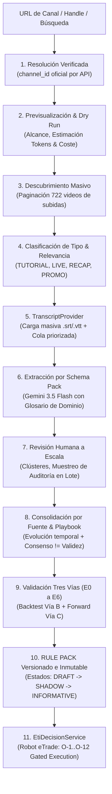

# Plan de Implementación: eTrade Trading Intelligence (ETI) — Addendum v2.3

**Documento Base:** [`C:\Fuentes\ETI\docs\eTrade_ETI_Addendum_v2_3_Ingesta_de_Canales_y_Consolidacion.md`](file:///C:/Fuentes/ETI/docs/eTrade_ETI_Addendum_v2_3_Ingesta_de_Canales_y_Consolidacion.md)  
**Versión del Plan:** 1.0  
**Fecha:** 1 de Noviembre de 2026  
**Caso de Referencia:** Canal de Opción Sigma (`https://www.youtube.com/@OPCIONSIGMA/videos` — 722 videos)  
**Objetivo Central:** Construir el flujo completo e industrializado: **Desde la URL de un canal hasta Rule Packs versionados e inmutables para el robot eTrade**.

---

## 1. El Flujo de Transformación ETI v2.3

---

## 2. Fases de Ejecución Detalladas

### Fase 1: Esquema de Base de Datos y Migración SQL 005
* **Archivo:** `C:\Fuentes\ETI\database\migrations\005_eti_ingestion_transcripts_rulepacks.sql`
* **Nuevas Tablas y Estructuras:**
  1. `eti_source_resolutions`: Registro de entradas del usuario, handles, URLs y candidatos de búsqueda resueltos al `channel_id` verificado.
  2. `eti_ingestion_runs`: Corridas de backfill/sync por canal con estado (`RUNNING`, `PAUSED`, `COMPLETED`, `CANCELLED`), embudo de progreso, presupuesto en USD asignado y consumido.
  3. `eti_ingestion_estimates`: Métricas estimadas (dry run) vs. consumo real post-primer lote.
  4. `eti_transcript_uploads`: Cargas manuales/masivas de archivos `.srt`, `.vtt`, `.txt`, `.json` con hash, idioma, cobertura y emparejamiento automático por ID/título.
  5. `eti_content_types` & `eti_prompt_profiles`: Clasificación de videos (`TUTORIAL`, `LIVE_SESSION`, `RECAP`, `MARKET_ANALYSIS`, `INTERVIEW`, `PROMO`) y plantillas de extracción asociadas.
  6. `eti_schema_packs`: Esquemas por tema (`OPTIONS`, `SCALPING`, `SWING`) que desacoplan el tipo de instrumento del pipeline.
  7. `eti_glossary_terms`: Glosario de dominio de opciones y finanzas (0DTE, GEX, gamma, delta, moneyness, strike, spread, VWAP...) para normalizar transcripciones.
  8. `eti_review_batches`: Lotes de revisión humana con registro de muestreo de auditoría obligatorio (% de revisión individual).
  9. `eti_rule_packs`, `eti_rule_pack_versions`, `eti_rule_pack_items`: Paquetes de reglas canónicos, versionados e inmutables con estados (`DRAFT`, `SHADOW`, `INFORMATIVE`, `SUPERSEDED`, `SUSPENDED`).

---

### Fase 2: Motor de Resolución y Backfill Masivo (Sprint ETI-S2)
* **Servicio de Resolución (`source_resolver.py` y `sourceResolverService.ts`):**
  * Acepta: `@OPCIONSIGMA`, `/channel/UC...`, `/c/...`, URL de video, o nombre ("Gala Trades").
  * Si es nombre, ejecuta búsqueda por API oficial de YouTube, retorna candidatos con miniatura, conteo de videos y última actividad para confirmación del usuario.
  * Valida y garantiza que **nunca se registre una Fuente sin `channel_id` verificado**.
* **Previsualización & Estimador Dry Run (`ingestion_estimator.py`):**
  * Previsualiza: horas estimadas, distribución por año/duración, % de directos largos.
  * Configuración del canal: Tema (`OPTIONS`), Rol (`ENTRY_RULES`, `MARKET_CONTEXT`), Prioridad, Ventana de vigencia (default 3 años: 2023-2026), Exclusiones (Shorts, directos > 4 horas) y Tope de Presupuesto en USD (corte duro).
  * Calcula estimación de cuota de YouTube (~35 unidades para 722 videos paginados en bloques de 50) y tokens aproximados.
* **Motor de Backfill Idempotente (`youtube_backfill_engine.py`):**
  * Descubre y cataloga todos los videos de la lista de subidas del canal.
  * Estados por video: `DISCOVERED` $\to$ `CLASSIFIED` $\to$ (`DISCARDED_IRRELEVANT` | `DISCARDED_OUT_OF_WINDOW` | `AWAITING_TEXT`) $\to$ `TEXT_READY` $\to$ `EXTRACTED` $\to$ `IN_REVIEW` $\to$ `REVIEWED`.
  * Procesamiento en orden de **relevancia descendente con desempate por recencia**.
  * Soporte de pausa, reanudación e idempotencia absoluta (sin re-descubrir lo ya indexado).

---

### Fase 3: Interfaz `TranscriptProvider` & Carga Masiva (Sprint ETI-S3 & Hito M1)
* **Arquitectura de Obtención de Texto (`transcript_provider.py`):**
  * Interfaz desacoplada: `get_text(video_id) -> text + timestamps + quality + provenance`.
  * `UserUploadProvider`:
    * Carga masiva de subtítulos en `.srt`, `.vtt`, `.txt`, `.json` o pegado directo.
    * Emparejamiento automático con los videos por `video_id` en el nombre de archivo o título coincidente.
    * Confirmación manual de los casos dudosos.
  * `Cola Priorizada de Texto Pendiente`:
    * Ordena los videos que esperan texto por valor esperado (score de relevancia, presencia de capítulos de estrategia, tipo tutorial).
    * Muestra al usuario los **Top N videos que más conviene aportar primero** (ej. los primeros 30-50).
  * Glosario de normalización de jerga financiera (`domain_glossary.py`).
* **Hito de Demostración M1 (Corte Vertical Obligatorio):**
  * Canal de Opción Sigma: 722 videos descubiertos y clasificados en metadatos.
  * $\ge 30$ videos con texto aportado y procesados con extracción de estrategias de opciones.
  * Verificación de métricas de calidad antes de extender el backfill a los demás canales.

---

### Fase 4: Consolidación y Rule Packs para el Robot (Sprint ETI-S4 & ETI-S4C)
* **Revisión a Escala (`scale_review_engine.py`):**
  * Agrupación automática de candidatos en clústeres por similitud semántica y hash DSL.
  * Fusión automática **únicamente para duplicados exactos** (mismo DSL normalizado).
  * Aprobación por lote con **muestreo de auditoría** configurable (ej. 15% de muestra revisada individualmente; si el error supera el 5%, se bloquea el lote).
* **Motor de Consolidación & Rule Packs (`rule_pack_engine.py`):**
  * Consolidación por Fuente: rastreo de evolución temporal (si el autor modificó un stop o regla, la versión vigente pesa más).
  * Consolidación entre Fuentes: Integración en el Playbook de Opciones (respetando *«Consenso no es validez»*).
  * Generación del **Rule Pack Versionado**:
    * Paquete inmutable con reglas en DSL, parámetros, régimen, nivel de evidencia y fuentes de origen.
    * Estados del ciclo de vida: `DRAFT` $\to$ `SHADOW` $\to$ `INFORMATIVE`.
    * El endpoint del robot (`EtiDecisionService`) sirve **únicamente Rule Packs aprobados en SHADOW/INFORMATIVE**, jamás candidatos o reglas sin validar.

---

### Fase 5: Rediseño Frontend — Panel de Ingesta y Rule Packs
* **1. Panel «Agregar Fuente» (`/sources/add`):**
  * Input inteligente (detecta @handle, URLs o ejecuta búsqueda de candidatos).
  * Tarjeta de previsualización (total de videos, horas, país, antigüedad).
  * Formulario de configuración (Tema, Rol, Prioridad, Ventana de vigencia, Exclusiones, Tope USD).
  * Panel de Estimación (Dry run) previo a la confirmación de inicio de backfill.
* **2. Monitor de Embudo en Vivo (`/sources/[id]/ingestion`):**
  * Embudo visual: `722 descubiertos → n relevantes → n con texto → n extraídos → n revisados → n aprobados → n consolidados`.
  * Botones de Pausa, Reanudación y Detención de emergencia.
  * Comparativa de Coste Estimado vs. Coste Real en vivo.
* **3. Gestor de Subtítulos y Cola Priorizada (`/sources/[id]/transcripts`):**
  * Zona drag-and-drop para múltiples archivos de subtítulos.
  * Tabla de emparejamiento con porcentaje de coincidencia.
  * Lista priorizada de los Top 30 videos recomendados para cargar texto.
* **4. Visor de Rule Packs (`/topics/options/rule-packs`):**
  * Catálogo de versiones de Rule Packs publicados.
  * Comparador visual de diferencias (*diff*) entre versiones de Rule Packs.
  * Trazabilidad completa desde la regla del robot hasta el video y timestamp del influencer.

---

## 3. Matriz de Entregables por Sprint Modificado

| Sprint | Código | Nombre y Alcance | Entregable Técnico |
| :---: | :--- | :--- | :--- |
| **S1** | `ETI-S1 v2.3` | Modelo de Ingesta, Subtítulos y Rule Packs | Migración `005_eti_ingestion_transcripts_rulepacks.sql` |
| **S2** | `ETI-S2 v2.3` | Panel Agregar Fuente & Backfill de 722 Videos | `source_resolver.py`, `youtube_backfill_engine.py`, UI `/sources/add` |
| **S3** | `ETI-S3 v2.3` | `TranscriptProvider`, Carga Masiva y Hito M1 | `transcript_provider.py`, cola priorizada, hito $\ge 30$ videos Opción Sigma |
| **S4** | `ETI-S4 v2.3` | Revisión a Escala y Muestreo de Auditoría | Clústeres de candidatos, aprobación en lote con muestreo |
| **S4C**| `ETI-S4C` | Motor de Consolidación y Rule Packs del Robot | `rule_pack_engine.py`, visor y comparador de Rule Packs |
| **S8** | `ETI-S8 v2.3` | API de Decisión alimentada por Rule Packs | `EtiDecisionService` sirviendo Rule Packs en `SHADOW`/`INFORMATIVE` |
