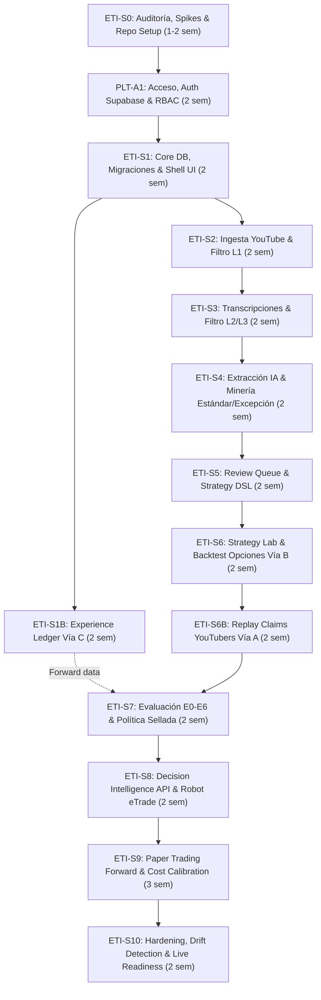

# eTrade Trading Intelligence (ETI) — Plan Maestro de Sprints y Construcción
## Extracción de Conocimiento de Opciones de 5 YouTubers, Minería de Reglas (Estándar vs. Excepciones), Validación en Tres Vías y Alimentación del Robot eTrade

**Versión:** 1.0  
**Fecha:** 31 de octubre de 2026  
**Documento Base:** Integración de `eTrade_ETI_Addendum_v2_1_Validacion_y_Acceso_claude.md` y `eTrade_Trading_Intelligence_Arquitectura_Antigravity_gtp.md`  
**Conectividad y Entorno:** Supabase PostgreSQL (`.env.local`), Fastify Engine (puerto 3001), Next.js Dashboard (puerto 3000), Python Analytics & Backtesting Engine  

---

## 1. Visión Ejecutiva y Propósito del Sistema

El objetivo de **eTrade Trading Intelligence (ETI)** es construir un sistema automatizado de inteligencia de mercado enfocado en **trading intradía de OPCIONES (CALL/PUT sobre activos US como SPY, QQQ, SPX)**. 

El conocimiento no se genera desde cero ni se copian señales a ciegas. Se alimenta de las **experiencias reales y operaciones relatadas por 5 traders destacados de YouTube**, extrayendo exclusivamente el contenido operativo, filtrando el ruido y comparando sistemáticamente sus enfoques para construir dos capas de conocimiento operativo:
1. **Reglas en Común (Estándar / Consenso):** La intersección disciplinaria compartida por la mayoría (gestión de riesgo, filtros de tendencia, selección de delta, confluencia de volumen y VWAP, horarios de no operación).
2. **Reglas Únicas (Excepciones Situacionales):** Arquetipos de "edge" táctico que un trader específico domina y que actúan como excepciones o *overrides* condicionales cuando el mercado entra en un régimen específico (e.g. 0DTE gamma squeeze, desvanecimiento de gaps extremos, reversión de volatilidad implícita).

Este conocimiento alimenta al robot de eTrade a través de una API de consulta determinística de solo lectura, protegido por filtros de riesgo (**ADUANA O-1 a O-12**), y validado rigurosamente mediante el **Marco de Tres Vías** y la **Jerarquía de Evidencia E0–E6**:
* **Vía A (Replay de afirmaciones):** Reconstrucción de las operaciones relatadas en los videos contra el libro histórico de opciones para medir plausibilidad y credibilidad del influencer.
* **Vía B (Backtest histórico de reglas):** Simulación cuantitativa de las reglas (estándar y excepciones) sobre datos históricos completos de contratos de opciones (bid/ask, slippage, comisiones, griegas).
* **Vía C (Experience Ledger de eTrade):** Registro inmutable en tiempo real de cada decisión, candidato evaluado, orden ejecutada en PAPER o LIVE y señal en sombra (`SHADOW_SIGNALS`), retroalimentando los costos reales al backtester.

```
                           +-------------------------------------------------+
                           |   5 Canales de YouTubers de Opciones US         |
                           +-------------------------------------------------+
                                                    |
                                                    v
                           +-------------------------------------------------+
                           |   Filtro Inteligente & Extractor IA             |
                           |   (Metadatos -> Transcripción -> Segmentación)  |
                           +-------------------------------------------------+
                                                    |
                       +----------------------------+----------------------------+
                       |                                                         |
                       v                                                         v
         +---------------------------+                             +---------------------------+
         |   Reglas Comunes          |                             |   Reglas Únicas           |
         |   (Estándar / Consenso)   |                             |   (Excepciones de Nicho)  |
         +---------------------------+                             +---------------------------+
                       \                                                         /
                        \                                                       /
                         v                                                     v
                       +---------------------------------------------------------+
                       |      Strategy Intelligence DSL & Knowledge Base         |
                       +---------------------------------------------------------+
                                 |                                   |
         (Vía A: Replay)         |           (Vía B: Backtest)       |
                 v               v                   v               v
         +---------------+---------------+   +---------------+---------------+
         | Plausibilidad | Credibilidad  |   | Simulación    | Métricas      |
         | de Operación  | de la Fuente  |   | Fuera Muestra | Robustez (E2) |
         +---------------+---------------+   +---------------+---------------+
                                                     |
                                                     v
                                     +-------------------------------+
                                     |  Políticas Selladas (E2+E3/E4)|
                                     +-------------------------------+
                                                     |
                                                     v
                                     +-------------------------------+
                                     | Decision Intelligence API     |
                                     +-------------------------------+
                                                     | (Read-Only)
                                                     v
+----------------------------------------------------------------------------------------------------+
| eTrade Trading Engine                                                                              |
|                                                                                                    |
|    Contexto Actual ----> [ ADUANA O-1..O-12 ] ----> [ Evaluación Reglas ETI ] ----> Ejecución     |
|                                                                                         |          |
|                                                                                         v          |
|    Experience Ledger (Vía C: Inmutable, Append-Only) <----------------------------------+          |
|    - EXECUTED (PAPER / LIVE)                                                                       |
|    - SHADOW_SIGNALS                                                                                |
|    - Candidatos Rechazados (Contrafactuales)                                                       |
|    - Calibración de Slippage & Spreads Reales hacia Vía B                                          |
+----------------------------------------------------------------------------------------------------+
```

---

## 2. Metodología de los 5 YouTubers: Consenso vs. Excepciones

Para asegurar una extracción equilibrada y contrastante, se parametrizan 5 perfiles arquetípicos de trading de opciones en índices estadounidenses (SPY/QQQ/SPX):

| Trader ID | Perfil Táctico | Activos & Temporalidad | Enfoque Primario | Aporte a la Base de Reglas |
|-----------|----------------|------------------------|------------------|----------------------------|
| **YT-01** | *Momentum Scalper 0DTE* | SPY / QQQ (1m, 2m, 5m) | Price Action, VWAP, Cruces EMA 9/20, Breakouts con volumen | Gatillos de aceleración y reglas de entrada por momentum. |
| **YT-02** | *Institutional Liquidity & S/R* | SPY / SPX (5m, 15m, 1h) | Order Blocks, Fair Value Gaps (FVG), Barridos de liquidez | Zonas de alta probabilidad institucional e invalidaciones estructurales. |
| **YT-03** | *GEX & Options Flow Specialist* | SPX / QQQ (Intradía) | Gamma Exposure (Call/Put Walls, Zero Gamma Flip), Unusual Options Activity | Filtro de régimen macrointradía y niveles donde los Market Makers aceleran o frenan el precio. |
| **YT-04** | *Mean Reversion & Gap Specialist* | SPY / IWM (5m, 15m) | Desvanecimiento de aperturas (Fade gaps), RSI sobrecomprado/sobrevendido con VWAP Stretch | Reglas de reversión a la media ante extremos estadísticos. |
| **YT-05** | *Risk Manager & Spread Strategist* | SPY / SPX (15m, 30m, 1D) | Credit/Debit Spreads intradía, Asimetría R:R, Control de Pérdida Diaria | Reglas de salida defensiva, trailing stops, dimensionamiento de posición y límites de drawdown. |

### 2.1 El Algoritmo de Minería: Síntesis y Clasificación de Reglas
1. **Extracción Normalizada:** Se extraen afirmaciones operativas de cada video y se mapean en entidades estructuradas (`eti_strategy_rules`, `eti_operations`).
2. **Clusterización Semántica:** Las condiciones de entrada, confirmación, stop e invalidación se agrupan por familia de indicadores (Tendencia, Volumen, Volatilidad, S/R, Griegas).
3. **Determinación del Consenso (Regla Estándar):**
   * Aquellas condiciones respaldadas por $\ge 3$ de los 5 autores con correlación lógica directa se promueven a **Regla Estándar**.
   * *Ejemplo Estándar:* No operar en los primeros 10 minutos (9:30-9:40 EST); operaciones CALL exigen precio sobre VWAP y EMA 9 > EMA 20; Stop Loss máximo del 15% del valor de la prima o quiebre del mínimo del swing previo; relación beneficio/riesgo proyectada $\ge 1.5:1$.
4. **Identificación de Excepciones (Reglas Únicas):**
   * Aquellas condiciones exclusivas de 1 o 2 autores que contradicen o matizan la regla estándar bajo circunstancias específicas de mercado se clasifican como **Reglas Excepción**.
   * *Ejemplo Excepción:* "Si hay apertura con GAP alcista > 1.8% y el precio toca la banda superior de Bollinger 2.5 std con divergencia bajista de volumen, se autoriza compra de PUT en contra de la tendencia general (Fade Trade), con toma de beneficios obligatoria en el VWAP de la sesión".

---

## 3. Hoja de Ruta de Sprints (Cronograma y Dependencias)

Siguiendo el orden arquitectónico mandatorio establecido en el Addendum v2.1:
$$\text{S0} \longrightarrow \text{PLT-A1} \longrightarrow \text{ETI-S1} \longrightarrow \begin{pmatrix} \text{ETI-S1B (Ledger)} \\ \parallel \\ \text{S2} \to \text{S3} \to \text{S4} \end{pmatrix} \longrightarrow \text{S5} \longrightarrow \text{S6} \longrightarrow \text{S6B} \longrightarrow \text{S7} \longrightarrow \text{S8} \longrightarrow \text{S9} \longrightarrow \text{S10}$$

* **Duración total estimada:** 20 a 24 semanas.
* **Paralelismo clave:** El Experience Ledger (**ETI-S1B**) se construye de forma temprana en paralelo a la ingesta de YouTube (**S2–S4**) para comenzar a acumular datos *forward* de eTrade lo antes posible.



---

## 4. Especificación Detallada de Sprints

### ETI-S0: Auditoría, Spikes Técnicos y Preparación del Entorno
* **Duración:** 1 a 2 semanas (7 a 10 días hábiles).
* **Dependencias:** `.env.local` con credenciales de Supabase.
* **Objetivo:** Verificar la integridad de los entornos de desarrollo, auditar los contratos de autenticación existentes de eTrade, analizar las estructuras de datos de opciones y validar la viabilidad técnica del replay de claims.
* **Entregables:**
  1. **Informe de Auditoría de Arquitectura:** Documento que valida el esquema de Supabase, variables de entorno y compatibilidad de Node/Python.
  2. **Spike D (Fuentes de Datos del Ledger en Opciones):** Mapeo exhaustivo de las tablas, eventos y estados del módulo de trading de eTrade (parámetros de órdenes, reglas de ADUANA O-1 a O-12, latencias de fill).
  3. **Spike E (Viabilidad de Replay de Claims):** Reconstrucción manual piloto de 10 operaciones declaradas en videos de prueba contra una muestra histórica de datos de opciones (proveedor D2).
  4. **Auditoría de Autenticación de Plataforma:** Diagnóstico del estado actual de auth para preparar el Sprint de acceso PLT-A1 sin introducir regresiones en el robot.
* **Criterio de Aceptación (DoD):**
  * Spikes D y E documentados y aprobados con riesgos y costes calibrados.
  * Cero modificaciones de código de trading en este sprint.
  * Checklist de no regresión para endpoints de eTrade aprobado.

---

### PLT-A1: Acceso, Autenticación y Seguridad a Nivel Plataforma
* **Duración:** 2 semanas (8 a 12 días hábiles).
* **Dependencias:** ETI-S0 completado y aprobado.
* **Objetivo:** Implementar la capa de identidad, autenticación y autorización segura para todo eTrade y el módulo ETI, aislando credenciales administrativas y de servicio.
* **Alcance Técnico:**
  1. **Supabase Auth:** Email/password con confirmación de correo, recuperación de contraseña y rotación de tokens.
  2. **Registro Controlado:** Sin auto-registro abierto; modelo por invitación con aprobación administrativa (`app_invitations`, `app_access_requests`).
  3. **MFA Obligatorio:** TOTP obligatorio para roles `owner` y `admin`.
  4. **Matriz RBAC:** Implementación estricta de roles: `owner`, `admin`, `trader`, `reviewer`, `viewer`, `service`.
  5. **Tokens de Servicio:** Tokens criptográficos con scopes definidos para workers y robot (`app_service_tokens`), con expiración y rotación. La clave `service_role` de Supabase jamás se expone al cliente web.
  6. **Políticas RLS Base:** Reglas Row-Level Security en Supabase para todas las tablas `app_*`.
* **Criterio de Aceptación (DoD):**
  * Flujo completo probado: Invitación $\to$ Aprobación $\to$ Registro $\to$ TOTP MFA $\to$ Login exitoso.
  * Endpoints protegidos con autorización en backend (`require_role(...)`).
  * Robot y workers comunicándose con tokens de servicio sin interacción de sesión humana.
  * Suite de regresión del motor de trading ejecutada con 100% de éxito.

---

### ETI-S1: Modelo de Datos ETI Core, Migraciones y Base Shell UI
* **Duración:** 2 semanas.
* **Dependencias:** PLT-A1.
* **Objetivo:** Desplegar el esquema de base de datos del módulo de inteligencia (`eti_*`), configurar migraciones automáticas y construir la navegación principal en el frontend Next.js.
* **Alcance Técnico:**
  1. **Migraciones PostgreSQL/Supabase:** Creación de tablas canónicas:
     * `eti_sources`, `eti_videos`, `eti_video_segments`, `eti_transcript_jobs`, `eti_extraction_runs`.
     * `eti_strategies`, `eti_strategy_rules`, `eti_operations`, `eti_indicators`, `eti_market_conditions`.
     * `eti_evidence`, `eti_reviews`, `eti_audit_log`.
  2. **Políticas RLS en `eti_*`:** Restringir lectura/escritura según roles de PLT-A1 (`reviewer`, `trader`, `admin`).
  3. **Backend API Shell (Fastify/Node):** Estructura base de rutas `/api/eti/v1/...` con inyección de cliente Supabase autenticado y validación JSON Schema.
  4. **Frontend Shell (Next.js):** Módulo ETI integrado en la navegación de eTrade (Dashboard, Sources, Videos, Knowledge Base, Review Queue).
* **Criterio de Aceptación (DoD):**
  * Migraciones aplicadas en Supabase con rollback testeado.
  * CRUD básico de canales (`eti_sources`) operativo desde la UI.
  * RLS verificada con tests automatizados (ej. `viewer` no puede editar fuentes).

---

### ETI-S1B: Experience Ledger (Vía C — Registro Prospectivo de eTrade)
* **Duración:** 2 semanas (ejecución en paralelo con S2–S4).
* **Dependencias:** ETI-S1.
* **Objetivo:** Construir el registro inmutable de decisiones y operaciones de eTrade, capturando en tiempo real cada candidato, decisión, regla ADUANA evaluada, orden ejecutada y señal en sombra.
* **Alcance Técnico:**
  1. **Tablas de Vía C:** `eti_experience_candidates`, `eti_experience_trades`, `eti_experience_snapshots`, `eti_shadow_signals`, `eti_cost_calibrations`.
  2. **Garantía Append-Only:** Triggers de base de datos que impiden físicamente `UPDATE` y `DELETE` sobre las tablas del ledger.
  3. **Captura Asíncrona:** Ingesta desacoplada mediante workers o sincronizadores periódicos para garantizar cero microsegundos de latencia añadida en la ruta de ejecución de eTrade.
  4. **Captura de Candidatos Rechazados:** Guardar contexto y métricas de aquellos candidatos bloqueados por las reglas de ADUANA (O-1 a O-12) para permitir análisis contrafactuales.
  5. **Doble Libro:** Separación estricta de `EXECUTED` (PAPER/LIVE) y `SHADOW_SIGNALS` (señales teóricas sin tope de 3 trades/día).
  6. **UI Básica:** Visualizador del ledger en el panel ETI con desglose de ejecución, slippage realizado y reglas ADUANA.
* **Criterio de Aceptación (DoD):**
  * Una operación simulada de eTrade genera su registro completo (decisión, ADUANA, snapshot, orden, fill, P&L) de forma atómica e idempotente.
  * Intento forzado de `UPDATE` sobre el ledger genera excepción SQL.
  * Cero llamadas bloqueantes en el loop de trading de eTrade.
  * Libros `EXECUTED` y `SHADOW_SIGNALS` completamente aislados en consultas estadísticas.

---

### ETI-S2: YouTube Ingestion & Smart Filtering L1 (Metadatos de 5 Canales)
* **Duración:** 2 semanas.
* **Dependencias:** ETI-S1.
* **Objetivo:** Conectar con los 5 canales de YouTube seleccionados, paginar catálogos extensos, almacenar metadatos e implementar el filtro inteligente de Nivel 1 para descartar contenido irrelevante antes de transcripción.
* **Alcance Técnico:**
  1. **Collector de Metadatos:** Ingesta de canales mediante YouTube Data API oficial o interfaces permitidas, con soporte de paginación por tokens y sincronización incremental.
  2. **Deduplicación & Cuotas:** Control de cuota API con backoff exponencial y deduplicación por `video_id`.
  3. **Smart Filtering Engine (Nivel 1):** Clasificador heurístico y por palabras clave sobre títulos, descripciones y tags. Taxonomía enfocada en:
     * Opciones CALL/PUT, 0DTE, SPY, QQQ, SPX, Price Action, VWAP, GEX, Live Trading, Recaps $\to$ Score Alto (70–100).
     * Cursos generales, podcasts $\to$ Score Medio (40–69).
     * Vlogs, viajes, lifestyle, crypto no relacionado $\to$ Score Descarte (0–39).
  4. **UI Video Library:** Lista de videos catalogados con score, filtros por canal y estado (`PENDING`, `DISCARDED`, `READY_FOR_ANALYSIS`).
* **Criterio de Aceptación (DoD):**
  * Sincronización exitosa de los 5 canales con más de 500 videos procesados sin duplicados.
  * El filtro L1 descarta al menos el 60% del contenido irrelevante sin consumir tokens de LLM ni transcripción.
  * Registro explícito del motivo de descarte para cada video excluido.

---

### ETI-S3: Transcript Access & Smart Filtering L2/L3 (Segmentación Semántica)
* **Duración:** 2 semanas.
* **Dependencias:** ETI-S2.
* **Objetivo:** Obtener transcripciones autorizadas exclusivamente para los videos seleccionados por el filtro L1, segmentar el texto por bloques temporales y aislar los pasajes que discuten operaciones reales y estrategias de opciones.
* **Alcance Técnico:**
  1. **Módulo de Transcripciones:** Adaptador de acceso a subtítulos/transcripciones oficiales mediante interfaces permitidas, registrando estados (`AVAILABLE`, `NOT_AVAILABLE`, `RESTRICTED`, `ERROR`).
  2. **Filtro de Contenido L2 (Muestreo de Texto):** Inspección de los primeros fragmentos para descartar videos que usen títulos *clickbait* sin contenido técnico real.
  3. **Segmentación Semántica (L3):** Algoritmo de chunking con ventana deslizante y solapamiento controlado que preserva marcas de tiempo (`start_seconds`, `end_seconds`).
  4. **Identificación de Bloques Operativos:** Detección de fragmentos donde el influencer relata:
     * Entradas, salidas, justificación técnica del trade.
     * Contratos operados (Strike, Expiración, Prima pagada).
     * Errores cometidos, invalidaciones y lecciones de gestión de riesgo.
* **Criterio de Aceptación (DoD):**
  * Extracción de segmentos temporales precisos en los videos seleccionados.
  * Ningún video descartado genera llamadas de transcripción pesada.
  * Almacenamiento exclusivo de resúmenes, entidades y timestamps; no se guarda la transcripción en bruto por defecto.

---

### ETI-S4: AI Knowledge Extractor & Minería de Reglas (Estándar vs. Excepción)
* **Duración:** 2 semanas.
* **Dependencias:** ETI-S3.
* **Objetivo:** Implementar los extractores basados en LLM para convertir los segmentos en esquemas estructurados Pydantic/JSON, y construir el motor de comparación que clasifica las reglas de los 5 YouTubers en Reglas Estándar (Consenso) y Reglas Excepción (Únicas).
* **Alcance Técnico:**
  1. **Pipeline de Extracción IA:** Prompts versionados de extracción semántica que aíslan:
     * Entidades: `Strategy`, `Rule` (Entrada, Confirmación, Invalidación, Stop, Target), `Operation` (Strike, DTE, Prima, P&L), `MarketCondition`.
     * Tipificación de Afirmaciones: `EXPLICIT_RULE`, `INFERRED_RULE`, `LIVE_CLAIM`, `RECAP_CLAIM`, `UNVERIFIED_CLAIM`.
     * Regla estricta de no invención: Campos no mencionados explícitamente se persisten como `NULL` en `unknown_fields`.
  2. **Motor de Síntesis y Comparación Multi-Trader:**
     * Algoritmo de normalización de reglas (mapeo a indicadores comunes: VWAP, EMA, S/R, GEX, RSI).
     * Detección de intersección: Reglas compartidas por $\ge 3$ YouTubers $\to$ **Regla Estándar (Consenso)**.
     * Detección de especificidades: Reglas de alto edge utilizadas por 1 YouTuber bajo condiciones particulares de volatilidad/gap $\to$ **Regla Excepción (Situacional)**.
  3. **Almacenamiento de Relaciones:** Guardar en `eti_strategy_rules` con flag `rule_nature` (`STANDARD_CONSENSUS` vs. `UNIQUE_EXCEPTION`) y trazabilidad al autor (`source_id`) y segmento de video.
* **Criterio de Aceptación (DoD):**
  * Extracción validada mediante esquemas estrictos sin errores de parseo.
  * Matriz comparativa generada entre los 5 YouTubers que muestra claramente:
    * 1 conjunto de Reglas Estándar (Baseline).
    * Catálogo de Reglas Excepción con sus condiciones de activación de contexto.
  * Trazabilidad 100% auditable: cada regla y operación cuenta con su URL de YouTube con timestamp exacto.

---

### ETI-S5: Human Review Queue, Knowledge Graph & Strategy DSL
* **Duración:** 2 semanas.
* **Dependencias:** ETI-S4.
* **Objetivo:** Dotar a los analistas de una interfaz de revisión humana para auditar, corregir o aprobar las extracciones, y compilar las reglas validadas en un Dominio Específico de Lenguaje (DSL) ejecutable por el motor de opciones.
* **Alcance Técnico:**
  1. **UI Review Queue:** Pantalla interactiva en Next.js para revisar extracciones en estado `PENDING`:
     * Comparativa lado a lado: Segmento de video (reproductor con timestamp) vs. Datos extraídos por la IA.
     * Herramientas de edición: Confirmar regla explícita, descartar alucinaciones, ajustar parámetros numéricos.
     * Asignación de estado: `STRUCTURED`, `REJECTED`, `UNCERTAIN`.
  2. **Strategy DSL Formal:** Definición del lenguaje estructurado para opciones intradía:
     ```json
     {
       "dsl_version": "1.0",
       "strategy_name": "CONSENSUS_VWAP_MOMENTUM_CALL",
       "nature": "STANDARD_CONSENSUS",
       "underlying": "SPY",
       "contracts": {"type": "CALL", "delta_min": 0.35, "delta_max": 0.50, "dte": 0},
       "preconditions": ["SESSION_TIME_AFTER_0940", "REGIME_TRENDING_UP"],
       "entry_triggers": ["PRICE_CROSS_ABOVE_VWAP", "EMA9_ABOVE_EMA20"],
       "stop_loss": {"type": "PREMIUM_PCT", "value": 0.15},
       "exceptions_applicable": ["EXC_01_EXTREME_MOMENTUM_OVERRIDE"]
     }
     ```
  3. **Knowledge Graph de Estrategias:** Relaciones jerárquicas en BD entre familias de estrategias, reglas estándar y sus excepciones autorizadas.
* **Criterio de Aceptación (DoD):**
  * Un revisor puede completar la auditoría de un video en menos de 3 minutos desde la UI.
  * Exportación de estrategias a código DSL determinístico validado contra JSON Schema.
  * Registro de auditoría (`eti_reviews`) con usuario, fecha y cambios realizados.

---

### ETI-S6: Strategy Lab & Motor de Backtesting de Opciones (Vía B)
* **Duración:** 2 semanas.
* **Dependencias:** ETI-S5 y dataset de datos históricos de opciones (D2).
* **Objetivo:** Construir el motor cuantitativo de backtesting capaz de simular contratos de opciones reales (bid/ask, slippage, comisiones, decay temporal theta) para evaluar de forma reproducible las Reglas Estándar y las Reglas Excepción.
* **Alcance Técnico:**
  1. **Integración de Datos de Opciones (Proveedor D2):** Conexión con datos históricos tick o 1-minuto de opciones sobre SPY/QQQ/SPX (ThetaData, ORATS o Massive), incluyendo cadenas históricas con bid, ask, open interest, volumen y griegas.
  2. **Motor de Ejecución Simulado:**
     * Simulación de fills pesimistas: Compra al Ask, venta al Bid.
     * Modelado de comisiones de broker e impacto de slippage.
     * Gestión del decaimiento temporal (Theta) y cambios en volatilidad implícita (Vega).
  3. **Evaluación de Reglas Estándar vs. Excepciones:**
     * Simulación A: Regla Estándar pura en todo el histórico.
     * Simulación B: Regla Estándar + Overrides de Reglas Excepción activadas por régimen.
     * Análisis comparativo: ¿Mejoran las excepciones el Profit Factor y reducen el Max Drawdown?
  4. **Protocolo Out-of-Sample:** Separación estricta de conjuntos de entrenamiento, test y validación fuera de muestra (walk-forward).
* **Criterio de Aceptación (DoD):**
  * Backtests 100% reproducibles con hash de dataset y versión de estrategia.
  * Simulación nunca utiliza solo precios del subyacente; calcula P&L real sobre primas de contratos de opciones.
  * Informe cuantitativo generado: Win Rate, Profit Factor, Expectancy, Max Drawdown, Sharpe Ratio, desglose por régimen.

---

### ETI-S6B: Replay de Operaciones Declaradas de YouTubers (Vía A)
* **Duración:** 2 semanas.
* **Dependencias:** ETI-S6 y extracciones de operaciones (`eti_operations`).
* **Objetivo:** Reconstruir las operaciones individuales que los 5 YouTubers relataron en sus videos contra los datos históricos reales de opciones para auditar su consistencia y calcular el índice de credibilidad de la fuente.
* **Alcance Técnico:**
  1. **Normalización del Trade Declarado:** Fecha de mercado, hora de entrada y salida, contrato (strike/expiración), prima reportada y P&L afirmado.
  2. **Replay Engine:**
     * Contrastar si el contrato existió y cotizó al precio reportado en el minuto declarado.
     * Simular el trade con fills pesimistas de mercado y calcular el P&L reconstruido.
  3. **Clasificación de Consistencia:**
     * `REPLAY_CONSISTENT`: Precios y P&L compatibles con los datos reales.
     * `REPLAY_PARTIAL`: Desviación material atribuible a ejecución optimista o spread irreal.
     * `REPLAY_INCONSISTENT`: Precios fuera de mercado o contrato inexistente.
     * `NOT_VERIFIABLE`: Datos insuficientes (no equivale a falso).
  4. **Cálculo del Claim-to-Rule Gap:** Medir la discrepancia entre los resultados de las operaciones mostradas selectivamente en video versus el resultado de aplicar la regla completa en todo el histórico (Vía B).
  5. **Métricas de Credibilidad (`eti_source_credibility`):** Scoring para ponderar la reputación de los 5 canales. **Aviso explícito:** Estas métricas solo priorizan la cola de análisis, **jamás aprueban estrategias para trading real**.
* **Criterio de Aceptación (DoD):**
  * 100% de operaciones declaradas procesadas con su etiqueta de consistencia.
  * El ranking de credibilidad no influye en los estados de validación técnica de la estrategia.
  * UI de Strategy Lab muestra el gráfico comparativo: P&L declarado vs. P&L reconstruido.

---

### ETI-S7: Framework de Evaluación y Jerarquía de Evidencia E0–E6
* **Duración:** 2 semanas.
* **Dependencias:** ETI-S6, ETI-S6B y datos del Experience Ledger (ETI-S1B).
* **Objetivo:** Implementar el motor de validación bajo la jerarquía de evidencia E0 a E6 y aplicar la política sellada de aprobación para promover estrategias a estado `VALIDATED`.
* **Alcance Técnico:**
  1. **Codificación de Niveles de Evidencia:**
     * E0: Afirmación de video sin verificar.
     * E1: Afirmación reproducida consistente (Vía A).
     * E2: Backtest de reglas aprobado fuera de muestra (Vía B).
     * E3: Señales ETI en sombra (`SHADOW_SIGNALS`).
     * E4: Operaciones de eTrade en PAPER registradas en el ledger.
     * E5: Operaciones de eTrade en LIVE registradas en el ledger.
     * E6: Auditoría broker verificada por humano.
  2. **Regla Sellada de Aprobación v2.1:**
     * Una estrategia solo alcanza `VALIDATED` si cumple: **E2 (Histórico) + Evidencia Forward (E3 y/o E4/E5) según umbrales predefinidos**.
     * Ni las afirmaciones de influencers ni un backtest aislado bastan por sí solos.
  3. **Máquina de Estados de Estrategia:** `DISCOVERED` $\to$ `STRUCTURED` $\to$ `BACKTEST_PASSED` $\to$ `PAPER_TRADING` $\to$ `VALIDATED` (o `SUSPENDED` / `REJECTED`).
  4. **Versionado Inmutable:** Cualquier cambio de parámetro crea una nueva versión de estrategia (`eti_strategy_versions`), reiniciando el ciclo de validación.
* **Criterio de Aceptación (DoD):**
  * Imposibilidad técnica de promover una estrategia a `VALIDATED` sin evidencia E2 y E3/E4 registrada.
  * Política sellada documentada e inmutable antes de ejecutar evaluaciones de aprobación.
  * Tablero de control de estados de estrategias en la UI.

---

### ETI-S8: Decision Intelligence API & Gateway del Robot eTrade
* **Duración:** 2 semanas.
* **Dependencias:** ETI-S7 y ETI-S1B.
* **Objetivo:** Exponer la API determinística de solo lectura para que el robot de trading de eTrade consulte estrategias validadas, evalúe el contexto de mercado en tiempo real y aplique las Reglas Estándar con sus Excepciones situacionales.
* **Alcance Técnico:**
  1. **Endpoints de Consulta (Read-Only):**
     * `GET /api/eti/v1/strategies/active`: Lista de estrategias `VALIDATED` vigentes.
     * `POST /api/eti/v1/recommendations`: Endpoint donde el robot envía el snapshot actual de mercado (SPY/QQQ, precio, VWAP, EMAs, IV, régimen, hora) y recibe:
       * Estrategia compatible.
       * Si aplica la **Regla Estándar** o si se activó una **Regla Excepción** específica.
       * Condiciones de invalidación y stop recomendados.
       * Bandera obligatoria `execution_allowed: false` por defecto (el robot decide).
  2. **Integración con eTrade y Filtros ADUANA:**
     * El robot recibe la recomendación y la somete a sus reglas determinísticas inmutables de riesgo (**ADUANA O-1 a O-12**).
     * Si ADUANA rechaza, se registra en `eti_experience_candidates` con el motivo exacto del rechazo.
  3. **Conexión con el Experience Ledger:** Cada consulta genera un `query_id` vinculado a la decisión que tomará el robot.
  4. **Mecanismo Fail-Safe:** Si ETI está caído o responde lento (>150ms), el robot descarta la señal y continúa con su comportamiento defensivo sin operar.
* **Criterio de Aceptación (DoD):**
  * Latencia de respuesta de la API < 50ms en entorno local.
  * El robot nunca ejecuta órdenes basándose en la API sin pasar por ADUANA.
  * Pruebas de integración: corte de red simulado en ETI no afecta la estabilidad del robot de eTrade.

---

### ETI-S9: Paper Trading Forward & Calibración Dinámica de Costes
* **Duración:** 3 semanas (más período de observación extendido).
* **Dependencias:** ETI-S8 y ETI-S1B operando en conjunto.
* **Objetivo:** Ejecutar la operativa en PAPER trading en tiempo real sobre opciones de SPY/QQQ, alimentando el Experience Ledger y calibrando dinámicamente los supuestos de costes del motor de backtesting.
* **Alcance Técnico:**
  1. **Ejecución en PAPER Trading:** Operaciones de opciones ejecutadas por el robot en entorno simulado de broker, registrando fills, timestamps y comisiones.
  2. **Libro `SHADOW_SIGNALS`:** Generación en paralelo de todas las señales teóricas de las estrategias ETI sin el límite de 3 operaciones diarias para acelerar el volumen de muestra forward (E3).
  3. **Calibración Dinámica de Costes (Vía C $\to$ Vía B):**
     * Medición del slippage real y spread observado en el ledger (`eti_experience_trades`).
     * Actualización versionada de los parámetros de coste del backtester (`eti_cost_calibrations`).
     * Cada nuevo backtest registra qué versión de calibración utilizó.
  4. **Informe de Atribución ETI:** Análisis estadístico que compara el rendimiento de las operaciones con contexto ETI versus operaciones sin él, segmentado por régimen de mercado.
  5. **Detección de No Estacionariedad:** Alertas automáticas si el rendimiento forward diverge de las métricas del backtest histórico E2.
* **Criterio de Aceptación (DoD):**
  * Al menos 60 operaciones en PAPER registradas de extremo a extremo en el ledger con cero duplicados.
  * Calibración de costes generada y aplicada con éxito en una re-ejecución del backtester.
  * Informe de atribución visible en la UI con advertencias automáticas de muestra insuficiente.

---

### ETI-S10: Hardening, Detección de Deriva y Preparación para LIVE
* **Duración:** 2 semanas.
* **Dependencias:** ETI-S9 completado con éxito.
* **Objetivo:** Blindar la infraestructura de producción, implementar monitoreo continuo de deriva de mercado (drift), auditar la seguridad y preparar los protocolos para la futura ejecución LIVE con dinero real.
* **Alcance Técnico:**
  1. **Monitoreo & Observabilidad:**
     * Dashboards de salud del sistema, consumo de tokens LLM, cuotas de APIs de YouTube y latencias de base de datos.
     * Alertas ante workers caídos o fallos repetitivos de extracción.
  2. **Detección de Deriva de Mercado (Market Regime Drift):**
     * Monitoreo continuo de volatilidad implícita (VIX/VXX) y correlación de opciones.
     * Suspensión automática (`SUSPENDED`) de estrategias cuyas condiciones de mercado base se hayan degradado.
  3. **Barrera de Seguridad contra Auto-Tuning:**
     * Se verifica que ninguna optimización automática modifique parámetros en producción.
     * Nuevas ideas generadas por el ledger se canalizan como hipótesis pre-registradas que requieren aprobación humana explícita.
  4. **Protocolo de Activación LIVE (Decisión D12):**
     * Definición de límites de capital estrictos para cuando se autorice ejecución real (tamaño mínimo de contrato, pérdida máxima diaria bloqueante).
* **Criterio de Aceptación (DoD):**
  * Auditoría final de seguridad y permisos RLS completada sin vulnerabilidades altas.
  * Protocolo de contingencia y kill-switch general de trading probado y documentado.
  * Sistema 100% operativo en producción con los 5 canales procesados y el robot de opciones consultando recomendaciones validadas.

---

## 5. Matriz de Trazabilidad: De los Videos al Robot

| Paso | Componente | Entrada | Transformación | Salida Persistida |
|:---:|:---|:---|:---|:---|
| **1** | YouTube Collector | 5 Canales de Trading | Paginación API + Filtro L1 Metadatos | `eti_videos` (Score $\ge 70$) |
| **2** | Transcript & Segmenter | Video ID seleccionado | Subtítulos oficiales + Chunking L3 | `eti_video_segments` (Timestamps Opciones) |
| **3** | AI Knowledge Extractor | Segmento de Video | Prompting LLM estructurado (Pydantic) | `eti_operations`, `eti_strategy_rules` |
| **4** | Rule Synthesis Engine | Reglas de los 5 traders | Algoritmo de Consenso vs. Excepciones | Reglas Estándar vs. Excepciones (`eti_strategy_rules`) |
| **5** | Review Queue & DSL | Reglas extraídas | Validación humana + compilador DSL | `eti_strategy_versions` (DSL canónico) |
| **6** | Replay Engine (Vía A) | Operaciones declaradas | Reconstrucción histórica de contratos D2 | `eti_claim_replays`, Credibilidad de autor |
| **7** | Options Backtester (Vía B)| Reglas DSL + Datos D2 | Simulación cuantitativa (bid/ask/griegas)| `eti_backtests` (Métricas E2) |
| **8** | Validation Engine | Resultados E2 + Ledger E3/E4 | Verificación de Política Sellada | `eti_validated_strategies` (`VALIDATED`) |
| **9** | Decision API | Snapshot de Mercado eTrade | Match de régimen + Regla Estándar/Excepción| Payload JSON de Recomendación al Robot |
| **10**| eTrade Robot & ADUANA | Recomendación + Filtros O-1..O-12 | Evaluación de riesgo determinística | Orden ejecutada (PAPER/LIVE) o Rechazo |
| **11**| Experience Ledger (Vía C)| Decisión, Orden, Fill, P&L | Captura append-only asíncrona | `eti_experience_candidates`, `trades` |
| **12**| Cost Calibration Loop | Fills & Slippage del Ledger | Estimación estadística de spread real | `eti_cost_calibrations` (Feedback hacia Vía B) |

---

## 6. Configuración de Entorno y Variables Verificadas (`.env.local`)

El desarrollo se apoya en los servicios ya configurados en la raíz del proyecto:
* **Supabase Database & Auth:**
  * URL: `https://cuyixoedyjabyltkjkej.supabase.co`
  * RLS y Roles gobernados por el `SUPABASE_SERVICE_ROLE_KEY` en backend y `NEXT_PUBLIC_SUPABASE_ANON_KEY` en cliente web.
* **Fastify Engine (API de Inteligencia):**
  * Puerto: `3001` (Host: `0.0.0.0`)
  * Secret: `ENGINE_TICK_SECRET`
  * CORS permitido: `http://localhost:3000` (Next.js)
* **Variables requeridas adicionales (a integrar en S0/S2/S6):**
  * `YOUTUBE_DATA_API_KEY`: Para descubrimiento e ingesta de metadatos de los 5 canales.
  * `HISTORICAL_OPTIONS_API_KEY`: Para proveedor D2 de datos históricos de opciones (ThetaData / ORATS).
  * `AI_EXTRACTOR_API_KEY`: API Key para el modelo LLM de clasificación y extracción de conocimiento estructurado.

---

## 7. Plan de Acción Inmediato: Próximos Pasos (Kickoff)

1. **Aprobación de este Plan de Sprints:** Confirmar el alcance y la división entre Reglas Estándar y Reglas Excepción.
2. **Ejecución de ETI-S0 (Fase 0):**
   * Inspeccionar y validar la conexión a Supabase con `.env.local`.
   * Ejecutar la auditoría de autenticación existente.
   * Diseñar los scripts de prueba para los Spikes D (Ledger de Opciones) y E (Replay de claims con muestra D2).
3. **Inicio de PLT-A1 y ETI-S1:** Despliegue de esquemas de autenticación y tablas `eti_*` en Supabase.
